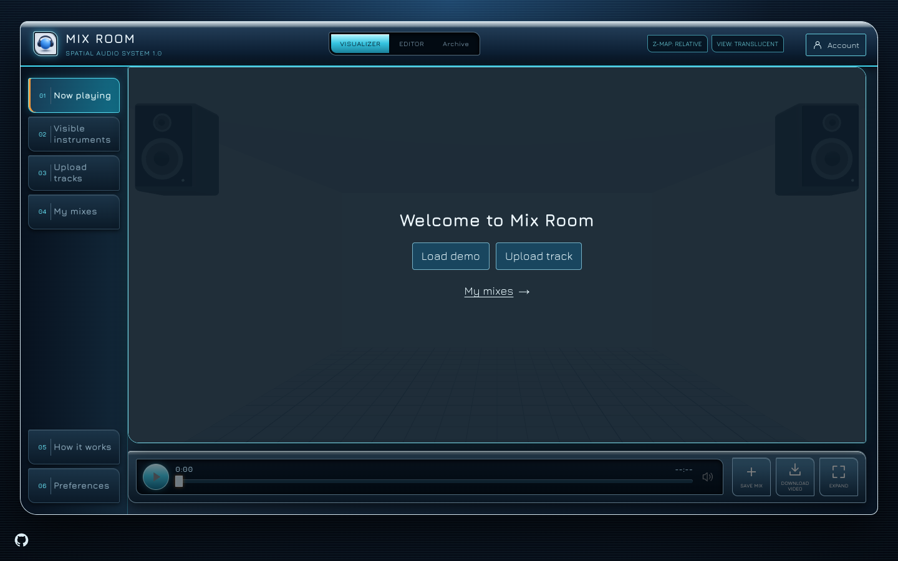
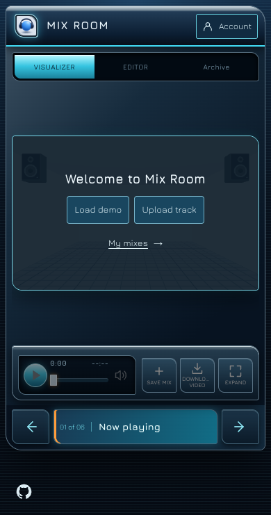
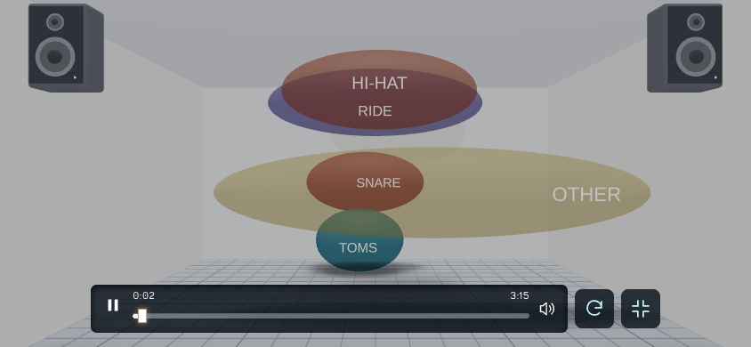

# Mix Room

**Visualize your mix.** Mix Room turns a song's instruments into shapes in a
3D room, so you can see where each part sits in the stereo field, how wide it
is, and when it's playing.

**Try it:** [mixroom.click](https://mixroom.click)



## What it does

- **See the stereo field.** Each instrument becomes a shape. Left–right
  position shows its pan, oval width its stereo width, height its brightness
  and depth its level, and it lights up while the part is active.
  ([What the shapes mean](docs/design/STEREO_VISUALS.md))
- **Bring your own music.** Upload separate instrument tracks (stems), or upload
  a finished song and have it separated into six stems: vocals, drums, bass,
  guitar, piano and other.
- **Guided demo.** A short tutorial walks through the room using
  *Demon Seed* by Nine Inch Nails.
- **Edit and export.** Rename the song and instruments, then download a video of
  the room with the audio.
- **Save your mixes.** Free accounts keep up to three private mixes.
- **Works on phones.** The layout adapts to portrait, landscape and desktop,
  with fullscreen playback.

| Phone | Fullscreen |
| --- | --- |
|  |  |

## How it works

1. **Separation (song uploads only).** The browser converts the song to WAV and
   uploads it to temporary private storage (Cloudflare R2). A Netlify Function
   sends it to [MVSEP](https://mvsep.com) for six-stem separation.
2. **Analysis.** Stems are analyzed in the browser in a Web Worker: loudness
   over time, stereo pan, width and correlation for every part. Your stems are
   never uploaded for this step.
3. **The room.** React Three Fiber renders each part as a shape and animates it
   with playback.

Accounts and saved mixes use Supabase (Postgres with row-level security) and a
private R2 bucket. Processing allowances, job ownership and monthly budgets are
enforced on the server.

**Built with:** React · Three.js (React Three Fiber, drei) · Vite · Netlify
Functions and Blobs · Supabase · Cloudflare R2 · MVSEP · Mediabunny (video
export) · Playwright (browser checks)

## Run it locally

You need Node 22.12 or newer.

```bash
npm install
npm run dev
```

Open the address Vite prints (usually `http://localhost:5173`). The demo,
stem uploads and video export work without any accounts or services.

Accounts, song separation and saving need your own Supabase, Cloudflare R2 and
MVSEP settings. Copy `.env.example` to `.env.local`, fill it in, and run
`npm run start:server`. Server keys stay in server-only variables; only the
Supabase URL and publishable key reach the browser.

## Checks

```bash
npm run check      # lint, unit tests and production build
npm run review     # four screen sizes in a real browser
```

`npm run review` uses Playwright. Install its browser once with
`npx playwright install chromium`.

## Project layout

| Folder | Contents |
| --- | --- |
| `src/` | The app: room, player, panels, accounts, browser analysis |
| `server/`, `netlify/functions/` | Separation, saved-mix and cleanup functions |
| `shared/` | Code used by both the browser and the server |
| `supabase/` | Database migrations and branded email templates |
| `scripts/` | Browser checks, build helpers and backup tools |
| `projects/` | Offline research tools for audio analysis and labeling |
| `docs/` | Design notes and screenshots |

## Credits

- **Demo music:** *Demon Seed* and *1,000,000* by Nine Inch Nails, from
  *The Slip* (2008), released under Creative Commons Attribution-NonCommercial-
  ShareAlike 3.0 US. See the license notes in `public/audio/`.
- **Fonts:** Jura and Arimo, SIL Open Font License (`public/fonts/`).
- **Icons:** Lucide, ISC License (`public/icons/Lucide-LICENSE.txt`).
- **Stem separation:** [MVSEP](https://mvsep.com).

## License

The code is released under the [MIT License](LICENSE). The demo audio, fonts and
icons keep their own licenses listed above.

Made by Iyanna Buffaloe.
